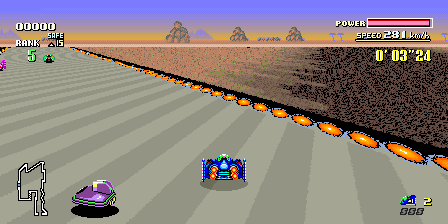
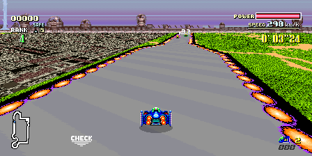
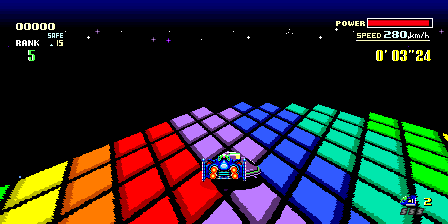
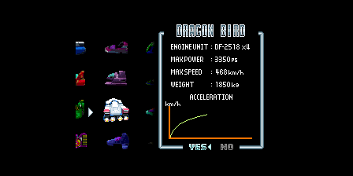
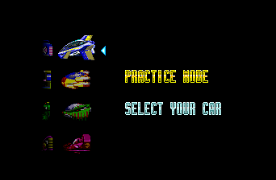
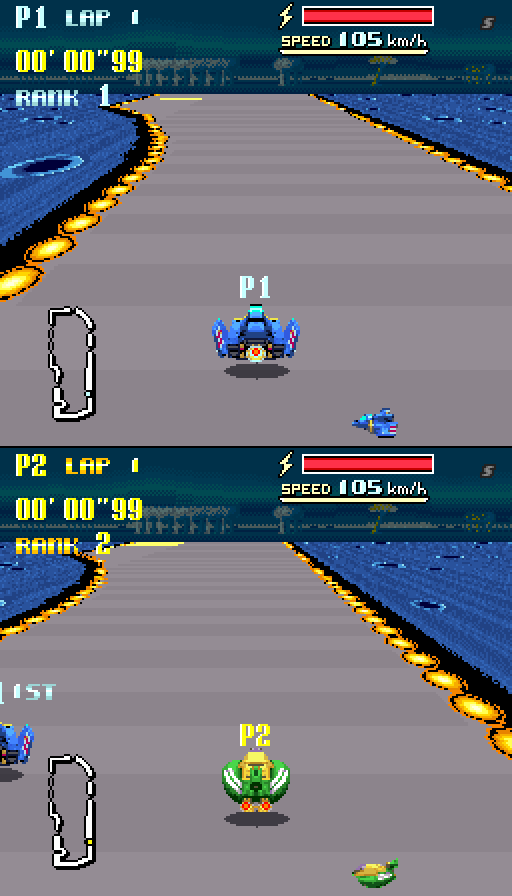
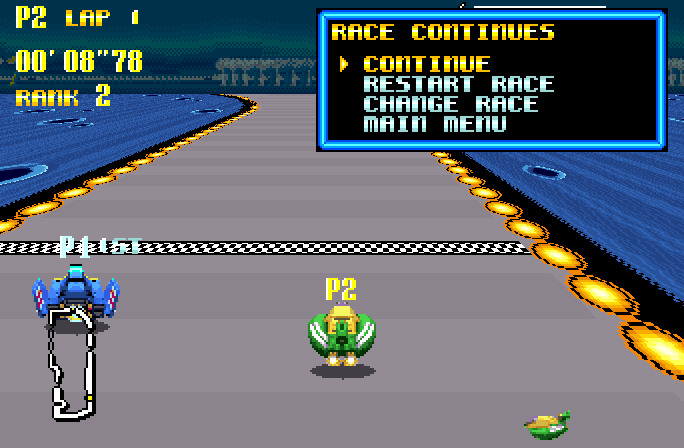
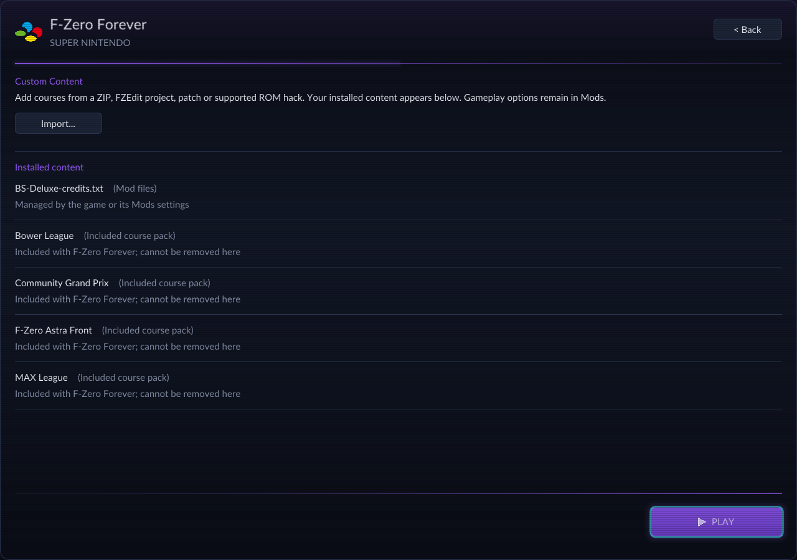
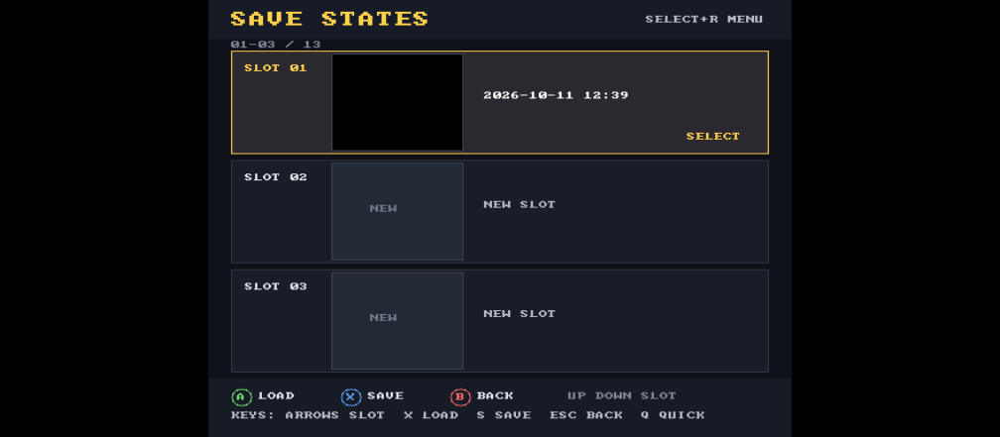

# F-Zero Forever

*The most tracks, most cups, split screen, up to 4p multiplayer, HD mode 7, for F-Zero.*

**F-Zero Forever is a modern PC conversion of the original SNES anti-gravity racer.**

**Rather than a predictable port of the game, our ambition was to push the game to new heights, with overwhelming amounts of modes and content, and all the technical improvements we could throw at it.**

Our team consists of veteran developers from the RetroPortingToolkit team, and F-Zero modders from the F-Zero Community Grand Prix team. For this special game, we spent over 7 weeks working on new features, daily.

## F-Zero Forever includes:

## 75 races. 15 cups.

We worked with the community and combined several of the highest quality rom hacks for the game, including: **Community Grand Prix, Astra Front, Bower, and MAX**. You can even bring your own rom hacks and create your own races. This is the largest combination of tracks EVER for F-Zero.

We made sure to preserve every custom feature that was built for each GP, including **CGP's magnets, jumps, and gravity changes**, with selectable gameplay rules and **Legend difficulty** for another challenge.



*Bower · Red Canyon III*



*MAX · Metal Forest*



*CGP · Rainbow Road*

## Twelve cars.

Choose from **twelve CGP machines**: eight additional vehicles and CGP versions of the original four, each with its authored artwork, handling, energy boosts, and exhaust. Explore separate vehicle packs and original-car rebalances, or enable the optional Satellaview machines!



*Dragon Bird · CGP roster*



*Blue Thunder · Satellaview roster*

## Introducing split-screen and netplay.

We have also added multiplayer! You can play with 2 players via local split-screen, or up to 4 players via online netplay. Each player can compete with their own vehicle, and we made sure that player collisions, bumper traffic, minimaps and race positions work correctly. Configure your players in the launcher, enable **Local Multiplayer**, then choose **VS MODE** on the title screen.

**Multiplayer supports rollback netcode**, LAN discovery, Direct IP, and online lobbies

## So many HD settings.

**HD Mode 7** reconstructs the track perspective with finer sampling at **2×, 4×, or 8× detail**, optional edge smoothing, and GPU rendering for every local player. Start at 2× when tuning performance; higher settings are more demanding.

Pair it with **16:9, 21:9, 32:9, or Fit** widescreen modes, or keep the classic 4:3 view. Presentation rates from **60 to 360 FPS** give high-refresh displays smoother motion, independently of the HD Mode 7 setting.


*Room to see the next corner: Forest III in widescreen.*

[HD Mode 7 options and performance →](docs/HD_MODE7.md)

Visuals are upgraded too: it supports any aspect ratio (including 16:9, 21:9, 32:9), unlimited frame rates, and HD Mode 7. It's the prettiest the game has ever looked.



*Two racers. Two views. One race.*

### Online, with the whole screen to yourself



*Online racing gives each player their own full viewport.*

[Local controls and setup →](docs/LOCAL_CONTROLS_AND_MODS.md) · [Netplay guide →](docs/NETPLAY.md)

## Bring your own races, or make them!

Bring your favorite supported hacks together instead of keeping each in a separate installation. The launcher's **Custom Content importer** accepts **F-Zero Edit projects, ZIP archives, IPS/BPS patches, and supported ROM hacks**, validating and installing compatible content into your library.

Create courses in F-Zero Edit and import them to race, or install a drop-in pack that keeps its **courses, cups, scenery, music, and supported mechanics** together. Track Pack Loader loads compatible installed packs alongside the original courses.



*Import supported content and browse your installed packs.*

**Already have a compatible pack?** Drop its folder or ZIP into `mods/packs` and restart. BS Satellaview Tracks and Track Pack Loader are mutually exclusive; vehicle options remain separate.

[Installing packs →](mods/README.md) · [Creating and importing content →](docs/PACK_FORMAT.md) · [Supported mechanics and mods →](MODS.md)

## And even more!

- **A soundtrack for every circuit.** Expanded MSU-1 support includes CGP and Astra soundtracks, course music, and menu/event songs in single-player and multiplayer. Missing tracks automatically fall back to SNES music.
- **Records that know what you raced.** Custom-course and vehicle-aware records and ghosts, expanded cup browsing, matching course scenery, and correct vehicle identities.
- **Another shot at that corner.** A save-state browser with thumbnails, twelve numbered slots, a dedicated Quick slot, and bindable keyboard/controller Quick Save and Quick Load shortcuts. Offline rewind lets you step back and try again.
- **Your own combination of mods.** Independent vehicle packs, original-car rebalances, editable gameplay presets, and selectable title-screen artwork.
- **The look you remember—or a new one.** CRT Soft, LCD Grid, Sharp, Warm Composite, and support for custom GLSL shaders.
- **Controls that fit your setup.** SDL gamepad support, configurable keyboard/controller bindings, and host shortcuts.
- **Satellaview on your PC.** Optional BS F-Zero Deluxe courses and vehicles, included with their authors' permission.



## A few useful shortcuts

| Action | Keyboard | Gamepad |
| --- | --- | --- |
| Open save-state browser | **F7** | **Select + R** |
| Open offline rewind | **R** | **Select + L** |
| Quick save / quick load | Assign in **Controls → Host Shortcuts** | Assign in **Controls → Host Shortcuts** |

Bindings are customizable. For save slots, shaders, HD Mode 7, music, and configuration details, see the [player guide](docs/PLAYER_GUIDE.md).

## Build something fast

```bash
git clone --recurse-submodules https://github.com/retroportingtoolkit/FZeroSNESRecomp.git
cd FZeroSNESRecomp
bash tools/bootstrap.sh
```

With the build dependencies installed, place your legally obtained USA ROM at `fzero.sfc` in the repository root, then generate and build:

```bash
bash tools/regen.sh
cmake -S . -B build -G Ninja -DCMAKE_BUILD_TYPE=Release
cmake --build build
```

The regeneration script verifies the ROM before generating source. ROMs, generated files, saves, captures, and builds stay out of git.

[Build and validation instructions →](docs/BUILDING.md) · [Contributing →](CONTRIBUTING.md) · [Conversion notes →](CONVERSION.md)

## Help improve the next lap

Found a problem? [Open an issue](https://github.com/retroportingtoolkit/FZeroSNESRecomp/issues) with your build version, platform, enabled mods, and steps to reproduce it.

For Windows playtest builds, reproduce the issue, quit, and run **Collect diagnostics.cmd** beside the game. Nothing uploads automatically. Diagnostic archives contain game memory, saves, and local paths; share them privately when appropriate.

[How to collect and replay diagnostics →](docs/DIAGNOSTIC_REPLAY.md)

## The people behind Forever

F-Zero Forever was made primarily as a collaboration between the **RetroPortingToolkit developers** and the creators of the **F-Zero Community Grand Prix ROM hack**.

| Role | Contributors |
| --- | --- |
| **Development** | **GameMaster** — [GitHub](https://github.com/mstan) · [1379.tech](https://1379.tech/) · Discord: `gamemaster` |
| **Design** | **Shokunin** — [GitHub](https://github.com/tetrisgm) · [Twitter](https://twitter.com/tetrisgm) |
| **QA** | **Worthy MF9**, **Fennor**, **MatoLabu** |

Built with **[SNESRecomp](https://github.com/RetroPortingToolKit/snesrecomp)**, **[RetroPortingToolkit](https://retroportingtoolkit.com)**, **[F-Zero CGP](https://romhackplaza.org/romhacks/f-zero-community-grand-prix-cgp-super-nintendo-romhack)**, and **F-Zero VS**. The launcher uses [recomp-ui](https://github.com/RetroPortingToolKit/recomp-ui).

**BS F-Zero Deluxe** is included with permission from **GuyPerfect, Porthor, and PowerPanda**. See [soundtrack attribution](assets/music/CGP_ATTRIBUTION.md) for music credits and provenance. Thank you to the course authors, contributors, and playtesters who help this project grow.

> **Bring your own game.** You need a legally dumped, unmodified **F-Zero (USA)** ROM in `.sfc` or `.smc` format. No ROM is included.

## License

Project code is licensed under the [MIT License](LICENSE), © 2026 Matthew Stanley. Bundled dependencies retain their own licenses, included under `licenses/` in releases. BS F-Zero Deluxe content is included with its authors' permission and is not covered by the project's MIT license.

*F-Zero belongs to Nintendo. No game ROM is distributed with this project.*
