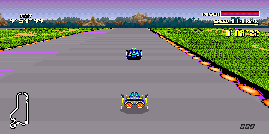
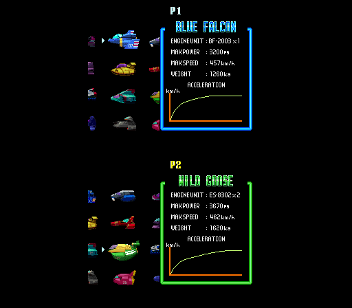
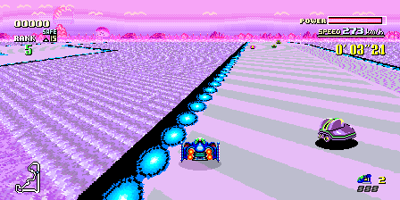
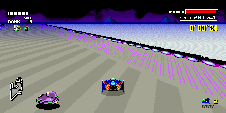
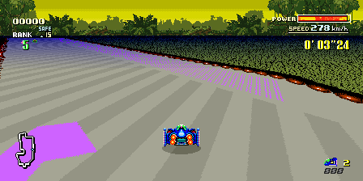
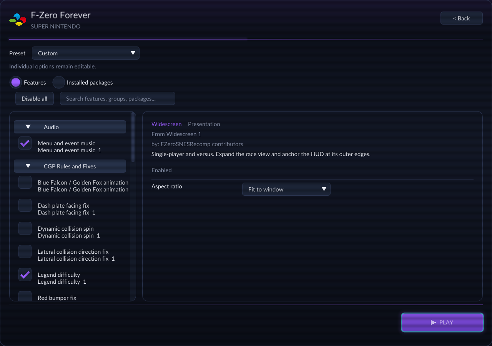
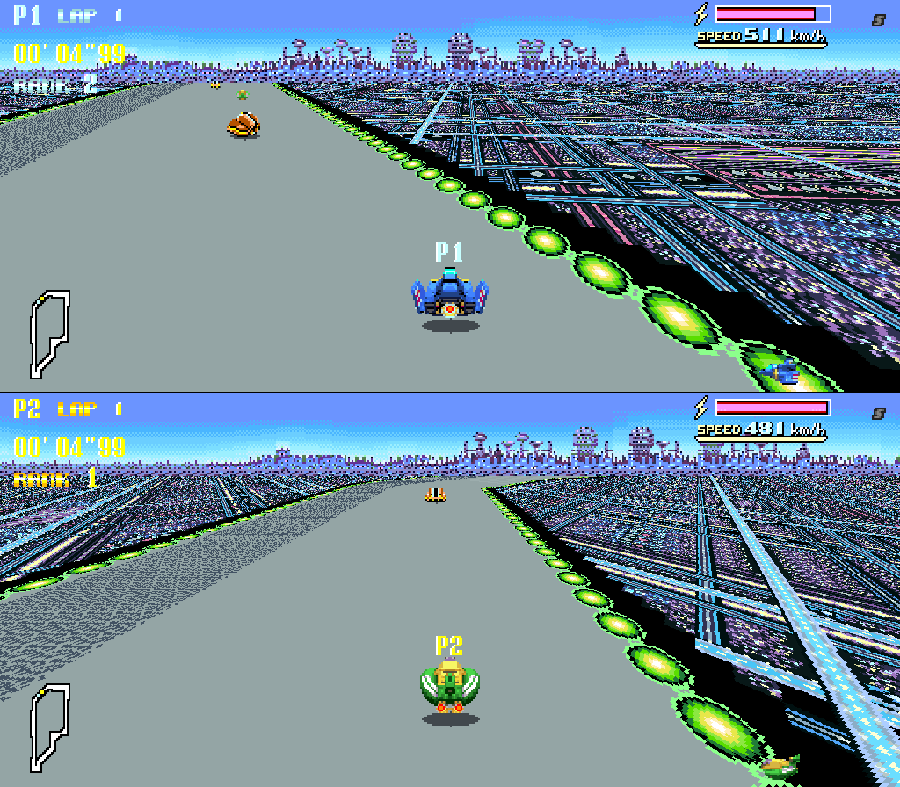
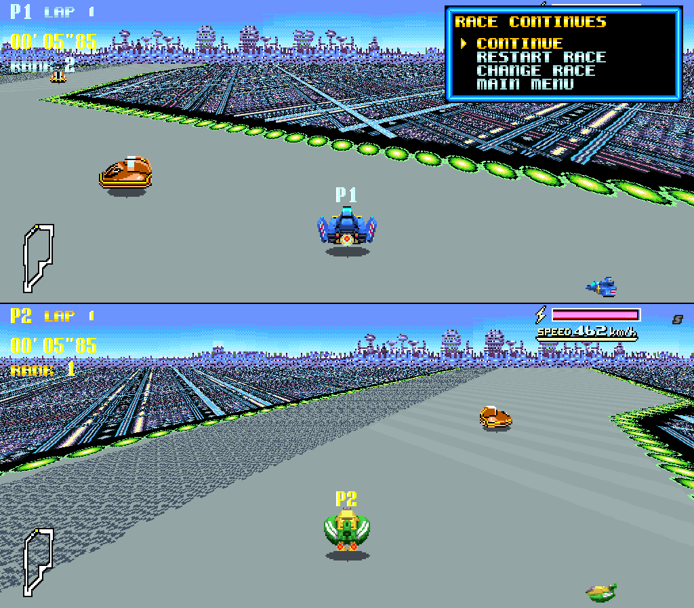
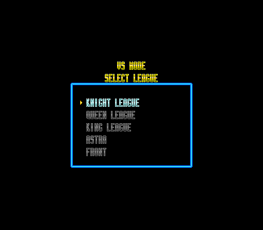
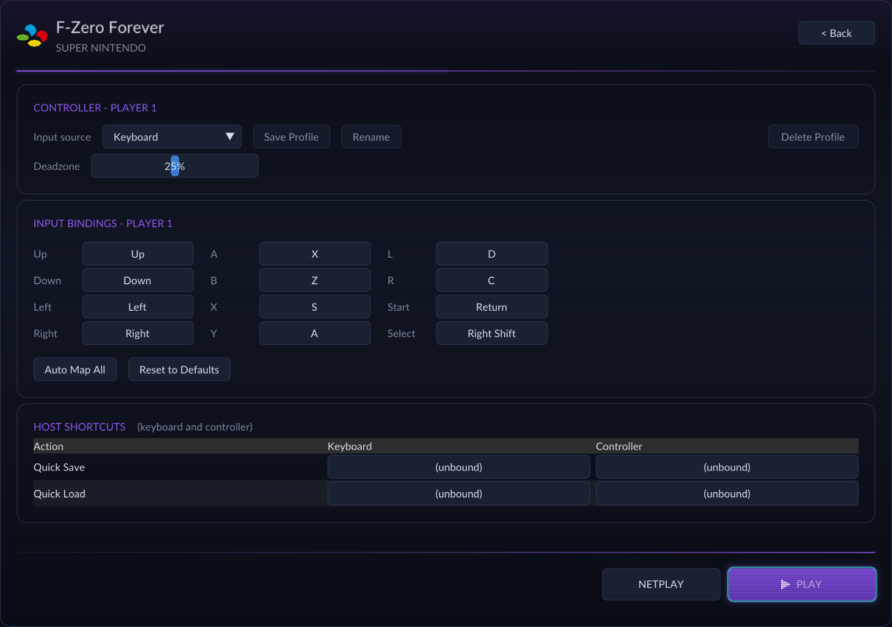

# F-Zero Forever

**75 course versions · 12 machines · Split-screen multiplayer (local & online) · HD Mode 7 · MSU-1 audio**

[**Download**](https://github.com/retroportingtoolkit/FZeroSNESRecomp/releases) ·
[**Features**](#more-racers-more-rivalries) ·
[**Get started**](#get-on-the-grid) ·
[**Player guide**](docs/PLAYER_GUIDE.md) ·
[**Contribute**](CONTRIBUTING.md)



*BS F-Zero Deluxe — Forest III in ultrawide.*

**F-Zero Forever is a native PC conversion of the original anti-gravity racer. It’s a special game with over 30 years of fandom. Our ambition was to go beyond what recomps usually do: simply make the game run on PC with some upgrades. We wanted to push the game further than it has ever gone.**

**It brings the original's breakneck racing together with an expansive collection of community tracks and machines, ambitious visual upgrades, and a whole new way to compete: local split-screen and online multiplayer.**

Race the original circuits, explore fifteen additional cups, or bring your own creations and supported ROM hacks into one shared course library. Choose your machine, tune your setup, and take it all to the starting line.

Made in collaboration by the **RetroPortingToolkit developers** and the creators of **F-Zero Community Grand Prix**.

> **Bring your own game.** You need a legally dumped, unmodified **F-Zero (USA)** ROM in `.sfc` or `.smc` format. No ROM is included.

---

## More racers. More rivalries.

### Split-screen, side by side

Turn a solo classic into a shared race. **Two to four players** can compete locally, with independent vehicle selection, player collisions, bumper traffic, and rematches. Every player gets their own view, race position, and minimap.

Two players race in top/bottom split-screen; three or four use a 2×2 grid. Configure your players in the launcher, enable **Local Multiplayer**, then choose **VS MODE** on the title screen.

<table>
  <tr>
    <td width="50%"><br><sub>Two racers. Two views. One race.</sub></td>
    <td width="50%"><br><sub>Pick your own machine before the race.</sub></td>
  </tr>
</table>

### Online, with the whole screen to yourself

Take the rivalry online with **rollback netcode**, LAN discovery, Direct IP, and online lobbies. Two to four participants race together, each with an independent full viewport. The host can choose 4:3, 16:9, or ultrawide 21:9.

Custom courses can join the competition too: everyone needs the same build and matching enabled course packs. Pack transfer is not automatic. Multiplayer races stay live, even while a player opens the race menu.

<p>
  
  <br>
  <em>Online racing gives each player their own full viewport.</em>
</p>

[Local controls and setup →](docs/LOCAL_CONTROLS_AND_MODS.md) · [Netplay guide →](docs/NETPLAY.md)

## A bigger world of F-Zero

### 75 course versions. 15 more cups.

Go beyond the original fifteen courses with **Community Grand Prix, Astra Front, Bower, and MAX**. Bundled courses arrive pre-cached and ready to race, bringing community creations together in one installation.

From Astra Front's candy-colored scenery to CGP's Rainbow Road, there's a new circuit around every corner. Supported custom mechanics include **CGP magnets, jumps, and gravity changes**, with selectable gameplay rules and **Legend difficulty** for another challenge.

<table>
  <tr>
    <td width="50%"><br><sub>Astra Front · Candany</sub></td>
    <td width="50%"><br><sub>Bower · Red Canyon III</sub></td>
  </tr>
  <tr>
    <td width="50%"><br><sub>MAX · Metal Forest</sub></td>
    <td width="50%"><br><sub>CGP · Mercury Sea</sub></td>
  </tr>
  <tr>
    <td width="50%"><br><sub>CGP · Huckmine</sub></td>
    <td width="50%"><br><sub>CGP · Rainbow Road</sub></td>
  </tr>
</table>

### Twelve machines. Find your favorite.

Choose from **twelve CGP machines**: eight additional vehicles and CGP versions of the original four, each with its authored artwork, handling, energy boosts, and exhaust. Explore separate vehicle packs and original-car rebalances, or enable the optional Satellaview machines.

<table>
  <tr>
    <td width="50%"><br><sub>Dragon Bird · CGP roster</sub></td>
    <td width="50%"><br><sub>Blue Thunder · Satellaview roster</sub></td>
  </tr>
</table>

## Your creations. Your course library.

Bring your favorite supported hacks together instead of keeping each in a separate installation. The launcher's **Custom Content importer** accepts **F-Zero Edit projects, ZIP archives, IPS/BPS patches, and supported ROM hacks**, validating and installing compatible content into your library.

Create courses in F-Zero Edit and import them to race, or install a drop-in pack that keeps its **courses, cups, scenery, music, and supported mechanics** together. Track Pack Loader loads compatible installed packs alongside the original courses.

<p>
  
  <br>
  <em>Import supported content and browse your installed packs.</em>
</p>

**Already have a compatible pack?** Drop its folder or ZIP into `mods/packs` and restart. BS Satellaview Tracks and Track Pack Loader are mutually exclusive; vehicle options remain separate.

[Installing packs →](mods/README.md) · [Creating and importing content →](docs/PACK_FORMAT.md) · [Supported mechanics and mods →](MODS.md)

## A wider horizon. A sharper track.

**HD Mode 7** reconstructs the track perspective with finer sampling at **2×, 4×, or 8× detail**, optional edge smoothing, and GPU rendering for every local player. Start at 2× when tuning performance; higher settings are more demanding.

Pair it with **16:9, 21:9, 32:9, or Fit** widescreen modes, or keep the classic 4:3 view. Presentation rates from **60 to 360 FPS** give high-refresh displays smoother motion, independently of the HD Mode 7 setting.

<p>
  
  <br>
  <em>Room to see the next corner: Forest III in widescreen.</em>
</p>

[HD Mode 7 options and performance →](docs/HD_MODE7.md)

## And even more!

- **A soundtrack for every circuit.** Expanded MSU-1 support includes CGP and Astra soundtracks, course music, and menu/event songs in single-player and multiplayer. Missing tracks automatically fall back to SNES music.
- **Records that know what you raced.** Custom-course and vehicle-aware records and ghosts, expanded cup browsing, matching course scenery, and correct vehicle identities.
- **Another shot at that corner.** A save-state browser with thumbnails, twelve numbered slots, a dedicated Quick slot, and bindable keyboard/controller Quick Save and Quick Load shortcuts. Offline rewind lets you step back and try again.
- **Your own combination of mods.** Independent vehicle packs, original-car rebalances, editable gameplay presets, and selectable title-screen artwork.
- **The look you remember—or a new one.** CRT Soft, LCD Grid, Sharp, Warm Composite, and support for custom GLSL shaders.
- **Controls that fit your setup.** SDL gamepad support, configurable keyboard/controller bindings, and host shortcuts.
- **Satellaview on your PC.** Optional BS F-Zero Deluxe courses and vehicles, included with their authors' permission.

<table>
  <tr>
    <td width="50%"><br><sub>Save slots and quick access</sub></td>
    <td width="50%"><br><sub>Choose your own mix of features</sub></td>
  </tr>
</table>

<details>
<summary><strong>More screenshots: race details, course selection, and controls</strong></summary>

<table>
  <tr>
    <td width="50%"><br><sub>Bumper traffic in multiplayer</sub></td>
    <td width="50%"><br><sub>The race continues while the menu is open</sub></td>
  </tr>
  <tr>
    <td width="50%"><br><sub>Original leagues and community cups</sub></td>
    <td width="50%"><br><sub>Configure controls and host shortcuts</sub></td>
  </tr>
</table>

</details>

Features above describe the current source tree. Packaged releases may lag behind it; see the [release notes](https://github.com/retroportingtoolkit/FZeroSNESRecomp/releases) for your download and the [changelog](CHANGELOG.md) for development updates.

---

## Get on the grid

### Windows

1. Download a **Windows x64 ZIP** from [Releases](https://github.com/retroportingtoolkit/FZeroSNESRecomp/releases).
2. Extract the **entire ZIP** into a folder.
3. Run **`F-Zero Forever.exe`**.
4. Select your own **F-Zero (USA)** `.sfc` or `.smc` ROM when prompted.

The app remembers your ROM path. Configure your controls in the launcher, then play.

| Download variant | What you get |
| :--- | :--- |
| **with-msu** | Includes the replacement Community Grand Prix PC-port soundtrack. |
| **without-msu** | Smaller download without soundtrack files. Use SNES audio or supply your own compatible music pack. |

Both variants support MSU-1 playback and include the same courses, cars, and gameplay options. Missing replacement tracks fall back to the SNES soundtrack. See the [music guide](docs/PLAYER_GUIDE.md#presets-and-msu-1-music) for setup and supported packs.

### Linux

[Build from source](docs/BUILDING.md), or use a Linux AppImage if one is provided with your chosen release. For an AppImage, place your USA ROM beside it, make it executable, and run it.

<details>
<summary><strong>Go straight to the game on your next launch</strong></summary>

Enable **Skip launcher on boot** to start with your remembered ROM. To return to the launcher, run `F-Zero Forever.exe --launcher`, or pass `--launcher` to your Linux AppImage. A missing or invalid remembered ROM opens the launcher automatically. See [launching](docs/PLAYER_GUIDE.md#launching) for the config setting.

</details>

## A few useful shortcuts

| Action | Keyboard | Gamepad |
| :--- | :--- | :--- |
| Open save-state browser | **F7** | **Select + R** |
| Open offline rewind | **R** | **Select + L** |
| Quick save / quick load | Assign in **Controls → Host Shortcuts** | Assign in **Controls → Host Shortcuts** |

Bindings are customizable. For save slots, shaders, HD Mode 7, music, and configuration details, see the [player guide](docs/PLAYER_GUIDE.md).

## Build something fast

```bash
git clone --recurse-submodules https://github.com/retroportingtoolkit/FZeroSNESRecomp.git
cd FZeroSNESRecomp
bash tools/bootstrap.sh
```

With the build dependencies installed, place your legally obtained USA ROM at `fzero.sfc` in the repository root, then generate and build:

```bash
bash tools/regen.sh
cmake -S . -B build -G Ninja -DCMAKE_BUILD_TYPE=Release
cmake --build build
```

The regeneration script verifies the ROM before generating source. ROMs, generated files, saves, captures, and builds stay out of git.

[Build and validation instructions →](docs/BUILDING.md) · [Contributing →](CONTRIBUTING.md) · [Conversion notes →](CONVERSION.md)

## Help improve the next lap

Found a problem? [Open an issue](https://github.com/retroportingtoolkit/FZeroSNESRecomp/issues) with your build version, platform, enabled mods, and steps to reproduce it.

For Windows playtest builds, reproduce the issue, quit, and run **Collect diagnostics.cmd** beside the game. Nothing uploads automatically. Diagnostic archives contain game memory, saves, and local paths; share them privately when appropriate.

[How to collect and replay diagnostics →](docs/DIAGNOSTIC_REPLAY.md)

## The people behind Forever

F-Zero Forever was made primarily as a collaboration between the **RetroPortingToolkit developers** and the creators of the **F-Zero Community Grand Prix ROM hack**.

| Role | Contributors |
| :--- | :--- |
| **Development** | **GameMaster** — [GitHub](https://github.com/mstan) · [1379.tech](https://1379.tech/) · Discord: `gamemaster` |
| **Design** | **Shokunin** — [GitHub](https://github.com/tetrisgm) · [Twitter](https://twitter.com/tetrisgm) |
| **QA** | **Worthy MF9**, **Fennor**, **MatoLabu** |

Built with **[SNESRecomp](https://github.com/RetroPortingToolKit/snesrecomp)**, **[RetroPortingToolkit](https://retroportingtoolkit.com)**, **[F-Zero CGP](https://romhackplaza.org/romhacks/f-zero-community-grand-prix-cgp-super-nintendo-romhack)**, and **F-Zero VS**. The launcher uses [recomp-ui](https://github.com/RetroPortingToolKit/recomp-ui).

**BS F-Zero Deluxe** is included with permission from **GuyPerfect, Porthor, and PowerPanda**. See [soundtrack attribution](assets/music/CGP_ATTRIBUTION.md) for music credits and provenance. Thank you to the course authors, contributors, and playtesters who help this project grow.

## License

Project code is licensed under the [MIT License](LICENSE), © 2026 Matthew Stanley. Bundled dependencies retain their own licenses, included under `licenses/` in releases. BS F-Zero Deluxe content is included with its authors' permission and is not covered by the project's MIT license.

*F-Zero belongs to Nintendo. No game ROM is distributed with this project.*
